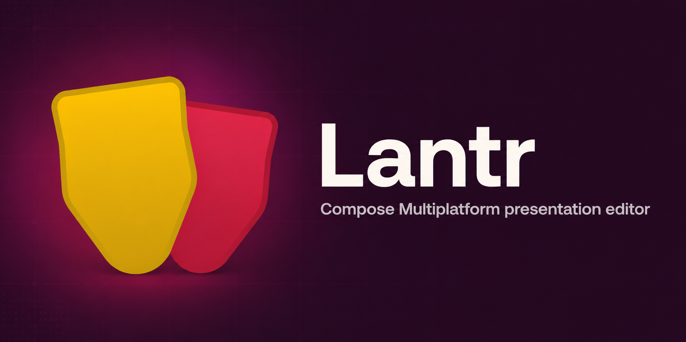
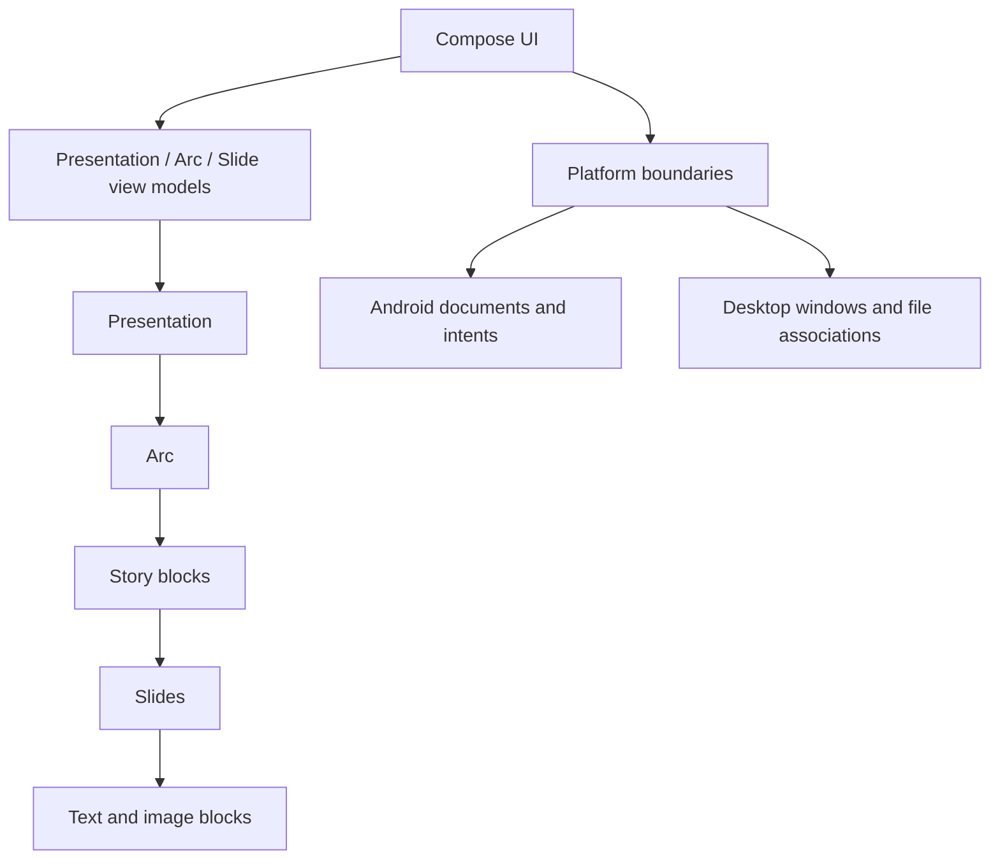

<p align="center">
  
</p>

<h1 align="center">Lantr</h1>

<p align="center">
  A narrative-first presentation editor for Android and Windows, built with Kotlin and Compose Multiplatform.
</p>

<p align="center">
  <a href="https://github.com/MasterplaYCoding/Lantr/actions/workflows/build.yml"></a>
  <a href="LICENSE"></a>
  
  
</p>

> **Retired product, maintained source archive.** Lantr explored a presentation workflow that begins with the speaker's argument and narrative arc rather than an empty slide. This repository preserves the Android and Windows app, its cross-platform engineering, and the experiments that shaped it.

## Why Lantr existed

Most presentation tools begin with a rectangle. Lantr began with the story: who is listening, what should change for them, and how should the argument unfold?

The editor connects two working modes:

- **Arc mode** structures the presentation as rhetorical sections and story blocks.
- **Slide mode** turns those blocks into visual moments with text, images, themes, alignment, and direct manipulation.

The result is a document editor where slides belong to a narrative instead of living in a flat list.

## What is here

- `composeApp` — the Compose Multiplatform application for Android and desktop JVM.
- `Experiments/DirectorService` — a testable Azure agent prototype that turns a brain dump into a proposed narrative arc.
- `Docs/Architecture` — subsystem notes for the model, canvas, drag and drop, document format, and platform boundaries.
- `Docs/CaseStudies` — engineering retrospectives, including what failed and what should change.
- `Docs/Experiments` — smaller design and technology studies.
- `Media` — project-owned brand and demonstration material.

## Architecture



Shared code owns the domain model, editor state, canvas behavior, themes, and most UI. Small platform boundaries handle documents, native image loading, drag and drop, window behavior, and `.ltrn` file integration.

Read the [architecture index](Docs/Architecture/README.md) or start with the [building Lantr case study](Docs/CaseStudies/Building-Lantr-with-Compose-Multiplatform.md).

## Requirements

- JDK 17
- Android Studio with an Android SDK for Android builds
- Windows, macOS, or Linux for desktop JVM development

```powershell
# Desktop app
.\gradlew :composeApp:run

# Desktop tests
.\gradlew :composeApp:jvmTest

# Android debug build
.\gradlew :composeApp:assembleDebug
```

The desktop distribution is configured for MSI, DMG, and DEB packaging. Windows is the maintained desktop target represented by this archive.

## Experiments

The archive separates experiments from shipped editor code. Each experiment must build independently, carry no bundled credential, and document its question and failure modes.

The first preserved experiment is [Director Service](Experiments/DirectorService/README.md): an Azure-backed prototype for mapping raw ideas into typed arc sections. Its HTTP boundary can be tested entirely offline.

## Sister project

[Dave Retegan's Apple-platform Lantr archive](https://github.com/Dave861/Lantr) preserves the native Swift product and Live Presenter speech-to-slides experiment. The repositories are separate implementations from the same wider product effort.

## History and people

Matei Ursache designed and built the Kotlin/Compose application represented here. Raul Boanca contributed to the wider Lantr effort and the original Director service prototype. David Retegan built the separate Apple-platform application and contributed to the shared product direction.

See [PROVENANCE.md](Docs/PROVENANCE.md) for the import boundary and [THIRD_PARTY_NOTICES.md](THIRD_PARTY_NOTICES.md) for dependency and asset attribution.

## Archive status

This is a portfolio and learning archive, not a hosted service. Focused fixes, documentation improvements, tests, and platform-compatibility updates are welcome. No Lantr account, production backend, or cloud credential is required to build the editor.

The project-owned source is MIT licensed unless a dependency or bundled asset states otherwise.
